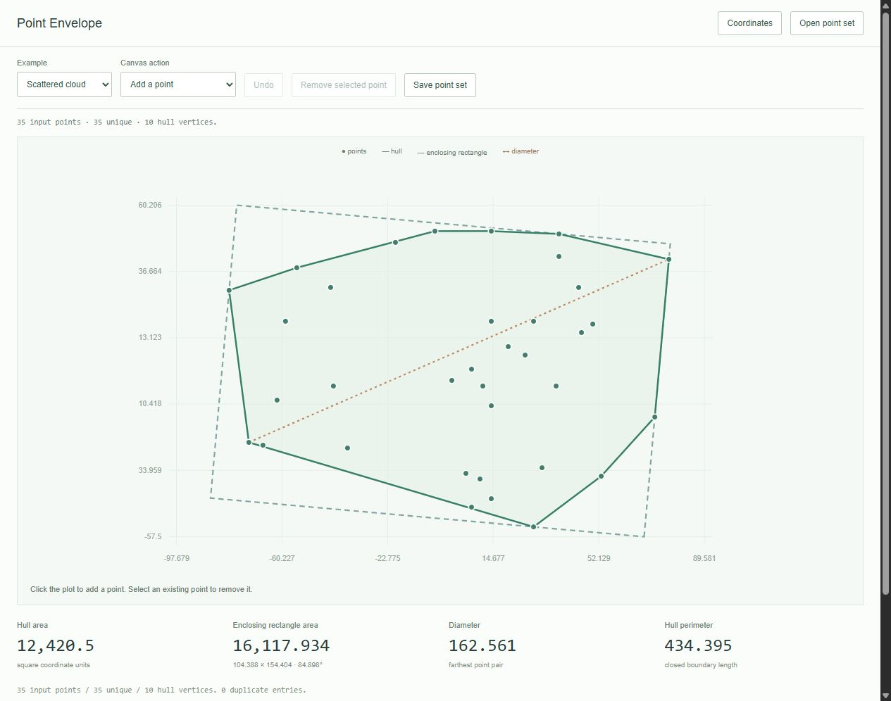

# Point Envelope

An editable computational-geometry workbench for point clouds. Draw or import coordinates, inspect the convex hull and smallest enclosing rectangle, and measure the farthest pair without losing sight of degenerate cases.



The plot occupies the main workspace, with measurements in a row below it. Open Coordinates to add or probe exact coordinates or edit the complete point list. Point buttons support keyboard selection and retain focus after redraw.

## Run

Requires Python 3.10+. No runtime dependencies or API keys.

```sh
python run.py --port 8000
```

Open http://127.0.0.1:8000/. All calculations run locally in a browser worker. Save the point set before refreshing; state and the last 50 edit snapshots live in memory.

## Workflows

- Add points by clicking the equally scaled plot or entering exact coordinates.
- Select points by mouse or keyboard, remove them, and undo edits.
- Probe whether integer coordinates lie inside, on the boundary of, or outside the hull.
- Inspect hull area/perimeter, the rotating-caliper diameter, and an oriented minimum-area enclosing rectangle.
- Import JSON, CSV, or plain coordinate text; export the point set, full geometry, or hull CSV.
- Explore a scattered cloud, a rotated rectangle, and a collinear set with duplicates.

[Example JSON](docs/example.json) describes a rotated 100-by-40 rectangle with interior points. Its hull area is 4,000, perimeter 280, and squared diameter 11,600.

## Geometry and precision

Input coordinates are integers from −10,000 to 10,000, with 1–500 points. Orientation cross products, shoelace area sums, and squared distances stay within JavaScript's exact integer range. Projected rectangle coordinates, angles, distances, and perimeters use floating-point arithmetic; displayed values round to three decimals while exports retain computed precision.

The monotone-chain hull sorts and deduplicates points and drops collinear interior edge points. It returns a counterclockwise boundary starting at the lexicographically smallest point. Rotating calipers finds an antipodal farthest pair, including equal-support cases. The enclosing rectangle checks every hull-edge orientation and projects the hull onto that edge's orthonormal axes. Complexity is O(n log n) for the hull, O(h) for diameter, and O(h²) for rectangles, with h hull vertices. Equal-area rectangle orientations can be nonunique; improvements smaller than 1e-8 square units retain the first candidate.

A single unique point has zero area, perimeter, and diameter. Collinear clouds reduce to their two extreme endpoints, with zero rectangle height and area. Their closed-boundary perimeter is twice the segment length. Such hulls have boundary and outside classifications, but no interior. Original duplicate entries remain editable while geometric calculations use unique coordinates.

Canvas additions and probes round to integer coordinates. Auto-fit includes the rectangle corners and preserves equal x/y scale. Probe coordinates outside the visible plot still receive a textual classification.

## Files

JSON contains a single `points` array of `{ "x": 0, "y": 0 }` records. CSV/plain text uses one `x,y` integer pair per line, with an optional `x,y` header on file import. Files are limited to 100 KB; coordinate text to 20,000 characters. A coordinate text edit becomes active only when applied. Invalid imports or edits preserve the existing point cloud.

## Verification

Requires Node.js 22+ for tests.

```sh
npm test
npm run check
python -m unittest discover -s tests -p 'test_*.py'
```

Ten JavaScript tests cover known shapes, duplicates, collinear and single-point cases, boundary queries, transformations, extreme coordinates, parsing, and immutability. An independent gift-wrapping implementation checks 300 random hulls, and exhaustive point-pair searches verify their diameters. Rectangle tests check containment and compare against dense angle sweeps. One Python test checks the static server. CI runs on Linux and Windows.

Browser checks exercise add/remove, undo, point selection, canvas additions, containment, collinear boundaries, CSV import, and exports. Independent Python verifies the downloaded shoelace area, exhaustive diameter, known rotated rectangle, and exported hull coordinates.

`core.js` implements pure geometry, `worker.js` isolates computation, and `app.js` renders the SVG plot and editing workflows. Revision guards prevent old worker results from overwriting a newer point set.
